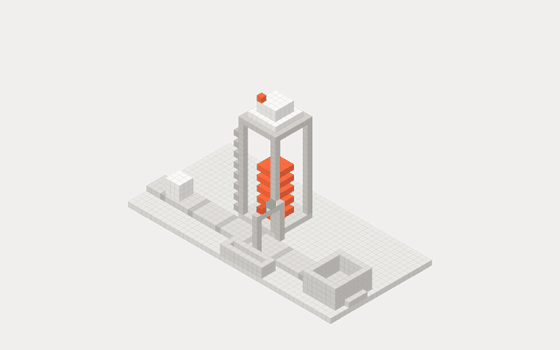
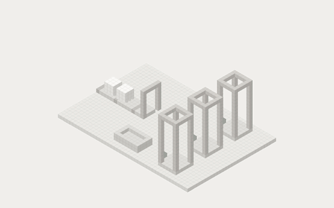
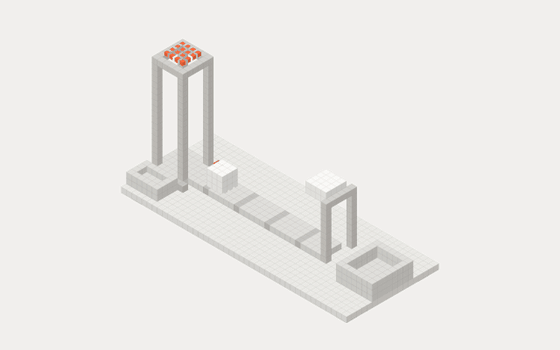
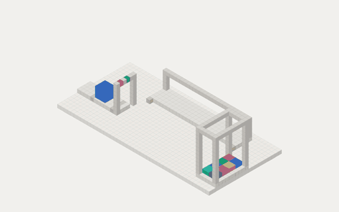
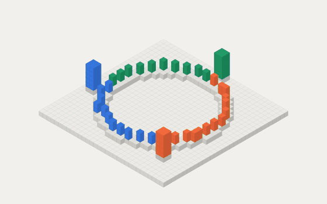
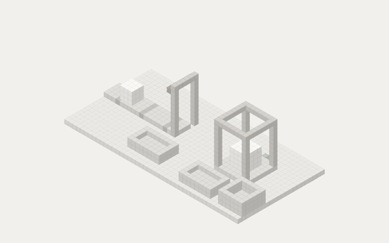

# cubewright

**Ideas, built as little cube machines you can play with.**

**▶ Play them: [thembatman0.github.io/cubewright](https://thembatman0.github.io/cubewright/)**

Cubewright is an agent skill (Claude Code and other agents that read `SKILL.md`). You ask it to explain a concept, and it builds a small, working voxel machine that shows the idea and lets you push it until it breaks. The output is one self-contained HTML page.

> *"How does a rate limiter work?"* A tap drips tokens into a tower. Requests ride a belt and must grab a token to pass the gate. Click to flood it and watch the rejects pile up.

## Why

- **Playable.** Every figure has an action that stresses the system, so the reader *causes* the interesting failure.
- **True.** A small real model drives the motion and the numbers. Nothing is decorative.
- **Fast and light.** A small canvas kit plus a parts library (a machine is ~60 lines), with no dependencies, no build step and no framework.
- **Quiet.** Clean, minimal styling: warm neutrals, one accent, light and dark themes.

## Install

```bash
git clone https://github.com/ThembaTman0/cubewright ~/.claude/skills/cubewright
```

Then ask Claude for an explainer, or run `/cubewright` followed by your idea.

## Try the example

```bash
node scripts/serve.mjs
```

Open `http://localhost:4317/examples/token-bucket/`.

Controls: **click** burst · **↑ ↓** refill rate · **← →** turn · **T** theme · **hover** name a part.

## Machines

| | |
|---|---|
| [](https://thembatman0.github.io/cubewright/examples/token-bucket/) | [](https://thembatman0.github.io/cubewright/examples/load-balancer/) |
| [](https://thembatman0.github.io/cubewright/examples/queue/) | [](https://thembatman0.github.io/cubewright/examples/lru-cache/) |
| [](https://thembatman0.github.io/cubewright/examples/consistent-hashing/) | [](https://thembatman0.github.io/cubewright/examples/circuit-breaker/) |

| # | Machine | Break it by |
|---|---|---|
| 01 | [Token bucket](examples/token-bucket/) · rate limiting | Bursting requests until the tower empties and 429s pile up |
| 02 | [Load balancer](examples/load-balancer/) · round robin vs least busy | Watching round robin overload the slow server, then failing a server |
| 03 | [Queue & backpressure](examples/queue/) · bounded queues | Raising arrivals above the press's speed until the source overflows |
| 04 | [LRU cache](examples/lru-cache/) · eviction | Scanning six cold keys so the shelf thrashes |
| 05 | [Consistent hashing](examples/consistent-hashing/) · sharding | Adding a server and comparing keys moved with `hash % n` |
| 06 | [Circuit breaker](examples/circuit-breaker/) · fault tolerance | Breaking the service until the breaker trips open |

## Layout

| Path | What |
|---|---|
| `SKILL.md` | The skill: principles, workflow, kit API, style rules |
| `kit/cubewright.js` | The renderer: voxel parts, isometric camera, culling, shading, picking, turning, motion loop |
| `kit/parts.js` | Machine parts with built-in motion (belt, stack, bin, lamp, gate, dial…) and `machine()`, which wires the page |
| `kit/page.css` | The shared, minimal page style |
| `examples/` | Finished machines to copy from |
| `scripts/serve.mjs` | A tiny local preview server |

## Roadmap

- More machines: replication and quorum, pub/sub, CDN, write-ahead log
- Export to `.vox` (MagicaVoxel) and glTF
- Shareable links and an embeddable web component

## Credits

The "the object is the explanation" idea was inspired by [Anatomy](https://github.com/wheresryan22/anatomy) by wheresryan22. Cubewright's kit, examples and style are independent work.

## License

MIT
